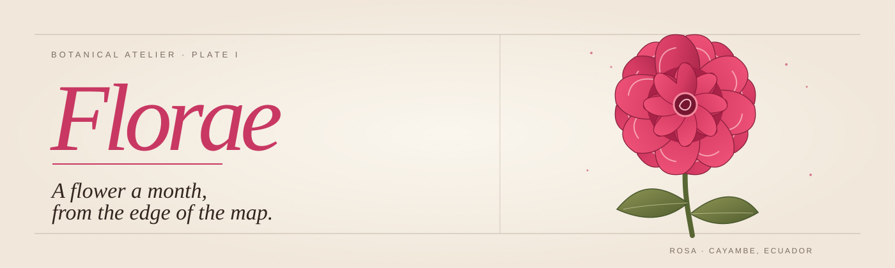
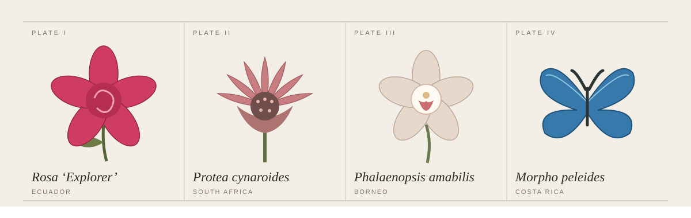
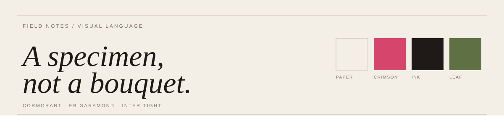
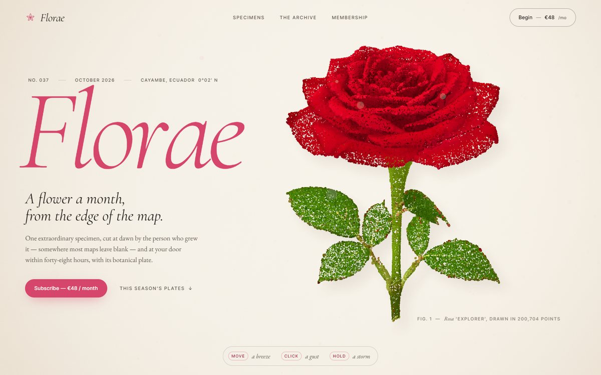

<p align="center">
  <a href="https://florae.aarya.cyou/"></a>
</p>

# Florae

*A flower a month, from the edge of the map.* · [Visit the site](https://florae.aarya.cyou/)

Florae imagines a botanical atelier that sends one remarkable specimen each month with its story, origin, and plate. The website treats the flower as something worth studying slowly: a living object, a field note, and a small piece of geography.

This is an interactive design concept. Its membership tiers and subscription invitations are part of the story, not a live shop or checkout.

## The idea

Most flower shops arrange many stems into one gesture. Florae gives a single specimen the whole page. The opening rose stands against warm paper; as the season unfolds, each plate pairs a botanical name with the place, grower, and conditions imagined for it.

The visual language borrows from a herbarium: generous margins, hairline rules, specimen numbers, measured labels, and elegant type. Crimson brings warmth to the cream and ink palette. The result is intended to feel closer to an archival publication than a storefront.

<p align="center"></p>

## This season's plates

| Plate | Specimen | Place in the story |
| --- | --- | --- |
| I | *Rosa* ‘Explorer’ | Cayambe, Ecuador — a rose shaped by equatorial sun and high nights |
| II | *Protea cynaroides* | Western Cape, South Africa — a dramatic flower of the fynbos |
| III | *Phalaenopsis amabilis* | Sabah, Borneo — an orchid from the canopy |
| IV | *Morpho peleides* | Osa Peninsula, Costa Rica — a blue visitor, deliberately breaking the flower sequence |

Beyond the four plates, the site imagines an archive of future months and three ways to receive a specimen. Those sections extend the editorial world; they do not process real orders.

## Visual language

Florae uses cream paper, crimson petals, dark ink, and restrained leaf green. Cormorant and EB Garamond carry the expressive text; Inter Tight gives the labels their precise, archival voice. The pointillist specimens and quiet typography leave room for each other.

<p align="center"></p>

## The site

The opening presents the rose and the atelier's premise. A specimen rail leads through the season, followed by the archive and membership concept. Pointer movement adds a breeze to the flowers, while the page remains readable as a sequence of editorial sections.

<p align="center">
  
</p>

<p align="center"><sub>Florae's opening scene, captured from the original project.</sub></p>

## Built with

| Part | Tools |
| --- | --- |
| Site and build | JavaScript, Vite, Tailwind CSS, custom CSS |
| Three-dimensional scene | Three.js, shaders, four GLB specimen models |
| Motion and scrolling | GSAP, ScrollTrigger, Lenis |
| Hosting configuration | Cloudflare Pages, `wrangler.jsonc` |

The site is one project at the repository root. Its source lives in `src/`, with rendering and interaction modules in `src/core/`. The specimen models are in `public/models/`; the original collection material is preserved separately in `docs/archive/`.

## Run locally

Use Node.js 22.12 or newer, then install and start Vite:

```bash
npm ci
npm run dev
```

The dev site runs at `http://127.0.0.1:5190/`. To check the production output locally:

```bash
npm run build
npm run preview
```

Vite writes the site to `dist/`; the preview runs at `http://127.0.0.1:5191/`.

## Deployment

The project website is [florae.aarya.cyou](https://florae.aarya.cyou/). For a Cloudflare Pages Git connection, use `main` as the production branch, `npm run build` as the build command, and `dist` as the output directory. The site uses the repository root. Cloudflare's **React (Vite)** framework preset provides those build values, and `wrangler.jsonc` records the Pages output directory.

## Repository guide

| Path | Contents |
| --- | --- |
| `index.html` | The single site entry |
| `src/` | Florae scene, styles, shaders, and shapes |
| `src/core/` | Rendering, assets, input, scroll, and UI utilities |
| `public/models/` | Four specimen models |
| `docs/` | Project art, screenshot, brief, credits, and notices |
| `docs/archive/` | Earlier collection and README material retained for reference |
| `wrangler.jsonc` | Cloudflare Pages output configuration |

## Rights and credits

The repository contains material with different terms. Permission to reuse one part does not extend to the others:

| Material | Terms |
| --- | --- |
| Adapted source code | [MIT license](LICENSE), with the original copyright retained |
| Florae-specific SVG art and original project presentation | [Florae content notice](LICENSE-FLORAE.md) |
| Zyrix Dev name and marks, where referenced | [Zyrix Dev brand notice](LICENSE-ZYRIXDEV.md) |
| 3D models and the website screenshot above | [Asset licenses](docs/ASSET-LICENSES.md) |
| Libraries and web fonts | [Third-party notices](docs/THIRD-PARTY-NOTICES.md) |

The source project and contributors are acknowledged in [Credits](docs/CREDITS.md). The original source copyright remains in the root [LICENSE](LICENSE).
